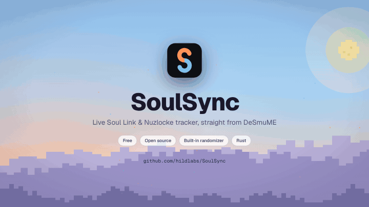
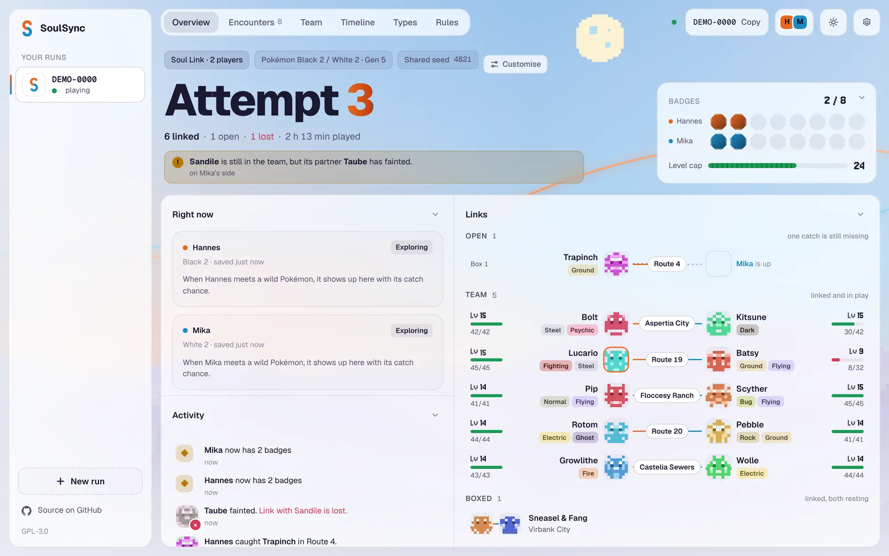
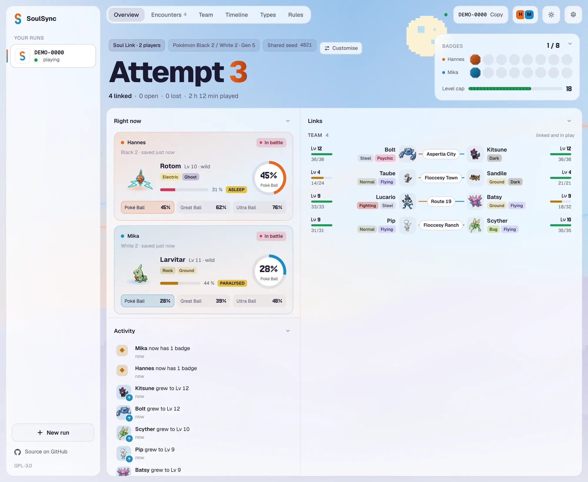
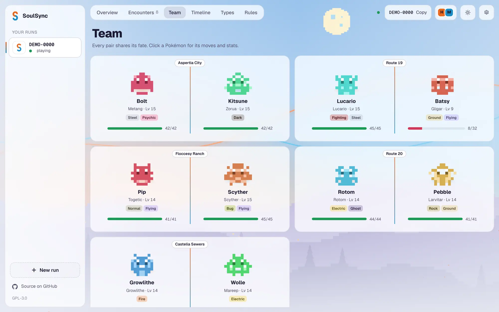
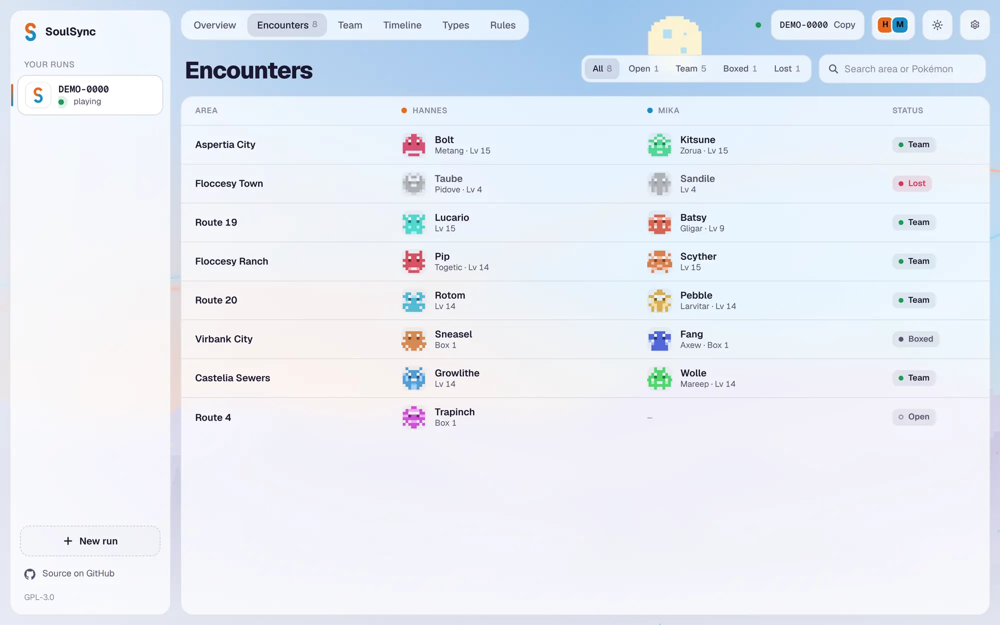

<p align="center">
  <picture>
  <source media="(prefers-color-scheme: dark)" srcset="docs/readme/header.svg">
  
</picture>
</p>

<p align="center">
  <a href="https://github.com/hildlabs/SoulSync/releases/latest"><picture><source media="(prefers-color-scheme: dark)" srcset="docs/readme/btn-download-dark.svg"></picture></a>&nbsp;
  <a href="#getting-started"><picture><source media="(prefers-color-scheme: dark)" srcset="docs/readme/btn-start-dark.svg"></picture></a>&nbsp;
  <a href="https://github.com/hildlabs/SoulSync/issues"><picture><source media="(prefers-color-scheme: dark)" srcset="docs/readme/btn-bug-dark.svg"></picture></a>
</p>

<p align="center">
  <a href="https://github.com/hildlabs/SoulSync/releases/latest"></a>
  <a href="https://github.com/hildlabs/SoulSync/actions/workflows/ci.yml"></a>
  <a href="LICENSE"></a>
  <a href="https://discord.gg/DKhuhJS8tJ"></a>
</p>

**SoulSync keeps track of your Nuzlocke or Soul Link run for you, live from the emulator.** You play Pokémon Black 2 or White 2 in DeSmuME as usual. SoulSync reads the game while you play and keeps the run up to date for everyone in it: catches, faints, links, badges and the rules. No spreadsheets, no bookkeeping in Discord.

<p align="center">
  <picture>
    <source media="(prefers-color-scheme: dark)" srcset="docs/screenshots/soulsync.gif">
    
  </picture>
</p>

<p align="center">
  <a href="#what-you-need"><b>What you need</b></a> ·
  <a href="#getting-started"><b>Getting started</b></a> ·
  <a href="#features"><b>Features</b></a> ·
  <a href="#how-it-works"><b>How it works</b></a> ·
  <a href="#faq"><b>FAQ</b></a>
</p>

### New to Soul Links?

A **Nuzlocke** is a challenge run with two core rules: you may only catch the first Pokémon you meet on each route, and a Pokémon that faints is gone for good. In a **Soul Link**, two or more friends play a Nuzlocke side by side. The catches they make on the same route are linked, and if one of them faints, its partners are lost too. Keeping all of that straight by hand gets tedious fast. SoulSync does it for you, solo or with up to four players.

> [!NOTE]
> **SoulSync is an early hobby project.** So far it has been tested on Windows with DeSmuME with the German Pokémon Black 2 up to the first gym, and with the German White 2 in a duo run with Black 2 up to the first wild encounters. Other games may follow. Expect bugs: please report them as an [issue](https://github.com/hildlabs/SoulSync/issues) or on the [Discord](https://discord.gg/DKhuhJS8tJ), and pull requests are very welcome. Large parts of the code were written with AI assistance; all of it is open source, so you can read every line.

## What you need

<picture>
  <source media="(prefers-color-scheme: dark)" srcset="docs/readme/needs.svg">
  
</picture>

- **A PC with Windows 10 or 11.** On a Mac, SoulSync runs DeSmuME through Wine, see [SoulSync on a Mac](docs/mac.md).
- **[DeSmuME](https://desmume.org)**, the free Nintendo DS emulator (Windows build). Its Lua scripting is what lets SoulSync follow the game live.
- **Your own copy of Pokémon Black 2 or White 2** as a ROM file. Both have been tested in German, Black 2 the furthest. SoulSync does not include or download games.

That's all: no account, and for Black 2 and White 2 no Java or separate randomizer either. Everyone in a Soul Link needs the same three things on their own PC.

## Getting started

<picture>
  <source media="(prefers-color-scheme: dark)" srcset="docs/readme/steps.svg">
  
</picture>

1. **Download** `SoulSync.exe` from the [latest release](https://github.com/hildlabs/SoulSync/releases/latest) and start it. It opens in its own window; new versions are offered in the top bar and install with one click.
2. **Start or join a run.** Enter your name, then choose *Start run* (pick the number of players and your rules) or *Join run* with the code a friend sent you.
3. **Pick your game.**
   - *Make a new game*: choose your original ROM and your DeSmuME `.exe`. SoulSync randomizes the ROM with the run's settings and opens it in DeSmuME with a new save.
   - *Game I already have*: choose the ROM and its `.dsv` save from DeSmuME's `Battery` folder.
4. **Play.** SoulSync sets up its Lua script to start with your game. *Settings › Live from DeSmuME* shows whether it is connected.

> [!TIP]
> **Windows may warn you on the first start.** The app is not code-signed yet, so SmartScreen shows *"Windows protected your PC"*. Choose *More info › Run anyway*. SoulSync is open source, and the exe is built from this repository by [GitHub Actions](https://github.com/hildlabs/SoulSync/actions/workflows/ci.yml), not on someone's PC. Every release lists the exe's SHA-256 checksum so you can check your download.

The app plays on the public SoulSync server out of the box, so sharing the run code is all it takes. Your ROM and your save never leave your computer; the server only receives what the dashboard shows.

<details>
<summary><b>Tips and troubleshooting</b></summary>
<br>

- **The Lua script does not start by itself?** Load it by hand in DeSmuME: *Tools › Lua Scripting › New Lua Script Window*, choose the file shown under *Settings › Live from DeSmuME* and press *Run*.
- **A catch that went straight to a PC box** shows as not caught until you save in-game, because the boxes arrive with your next save.
- **An encounter recorded by mistake** can be removed under *Encounters* with *Remove* next to your entry.
- **Your starter fainted in the first rival fight?** The run begins with your first catch, so that link is not lost.
- **Windows 10:** the window uses Microsoft's WebView2 runtime, which most computers already have. Without it, SoulSync opens in your browser instead.
- **Found a bug?** *Settings › Report a problem* puts the logs that help into one zip file. Nothing is sent anywhere; attach it to an [issue](https://github.com/hildlabs/SoulSync/issues).
- The script only trusts a party that has your own trainer behind it in memory, so an opponent's team is never mistaken for yours.
- Under *Server* you can enter your own server, or leave it empty to keep the run on your computer. Under *Settings › Run › Updates* you can get preview builds, made from every change.

</details>

## Features

- **Live from the emulator.** A small Lua script inside DeSmuME reads your party, the wild Pokémon you face and your bag while you play. Catches, faints and level-ups show up within a second or two, for everyone in the run.
- **Links and encounters, automatic.** The first encounter of every location is recorded for each player and paired up. A Pokémon you fail to catch closes the location for the whole group.
- **Solo or with up to three friends.** Play a classic Nuzlocke on your own, or a Soul Link with two to four players. Everyone sees all teams, the shared activity feed and who is in battle right now.
- **Rules that watch themselves.** Level caps read from the gym leaders in your ROM, shared fate, "together or not at all", failed catches. SoulSync points out when a team breaks one; it never stops you from playing.
- **Catch odds in battle.** The wild Pokémon's HP, status and the Poké Balls in your bag give the chance to catch it, before you throw.
- **A randomizer built in.** SoulSync randomizes your original ROM itself, with every option of Universal Pokémon Randomizer ZX for Black 2 and White 2, preset for Soul Link. A new attempt rerolls the game and starts a fresh save in one click, with Rare Candies in the bag if you like.
- **Made for randomized games.** Moves, abilities and learnsets come from each player's own ROM, so the dashboard shows what is really in it.
- **Runs that last.** Pause a run, switch to another and come back later. Every attempt keeps its real time played, and once it ends, won or lost, it goes to an archive with its badges and final teams.
- **English and German**, light and dark.

<p align="center">
  <picture>
    <source media="(prefers-color-scheme: dark)" srcset="docs/screenshots/overview-dark.webp">
    
  </picture>
</p>

<table>
  <tr>
    <td width="33%"><picture><source media="(prefers-color-scheme: dark)" srcset="docs/screenshots/battle-dark.webp"></picture></td>
    <td width="33%"><picture><source media="(prefers-color-scheme: dark)" srcset="docs/screenshots/team-dark.webp"></picture></td>
    <td width="33%"><picture><source media="(prefers-color-scheme: dark)" srcset="docs/screenshots/encounters-dark.webp"></picture></td>
  </tr>
  <tr>
    <td align="center"><sub>Everyone's catch chance, live in battle</sub></td>
    <td align="center"><sub>Every pair shares its fate</sub></td>
    <td align="center"><sub>One row per location</sub></td>
  </tr>
</table>

## How it works

<picture>
  <source media="(prefers-color-scheme: dark)" srcset="docs/readme/flow.svg">
  
</picture>

SoulSync reads the game **from the outside**, through the save file and the emulator's memory, instead of modifying or bundling an emulator. The app turns what it reads into a snapshot and sends it to the run server, which pairs up encounters, applies the rules and pushes the new state to everyone in the run over WebSocket. The dashboard is a web page served by the run server, so anyone with the link can watch along in a browser.

## FAQ

<details>
<summary><b>Does SoulSync come with the game?</b></summary>
<br>
No. SoulSync does not include, download or link to games. Every player uses a ROM of their own copy of the game.
</details>

<details>
<summary><b>Which games and languages work?</b></summary>
<br>
So far SoulSync has been tested with Pokémon Black 2 in German up to the first gym, and with White 2 in German in a duo run with Black 2, up to the first wild encounters. Black and White and other languages are meant to work too, but none of them have been tested yet. If you try one, please tell us how it went. More games are on the <a href="#roadmap">roadmap</a>.
</details>

<details>
<summary><b>Do I have to play randomized?</b></summary>
<br>
No. With <i>Game I already have</i> you play whichever ROM and save you choose, randomized or not. The built-in randomizer is there for when you want it.
</details>

<details>
<summary><b>Can friends watch without playing?</b></summary>
<br>
Yes. The dashboard is a web page on the run server, so anyone with the link can follow the run in a browser.
</details>

<details>
<summary><b>Does it work with melonDS, mGBA or a real DS?</b></summary>
<br>
Not yet. Live tracking needs DeSmuME's Lua scripting. Other emulators are on the <a href="#roadmap">roadmap</a>. On a Mac without Wine you can play in any emulator and pick its save; the dashboard then only updates when you save in-game.
</details>

<details>
<summary><b>Was it made with AI?</b></summary>
<br>
Partly. SoulSync is a hobby project, and large parts of the code were written with AI assistance and then tested in real runs. It is all open source under GPL-3.0, so you can read, check and improve every line. The hope is to get open-source work on Nuzlocke tools rolling, so contributions of any size are welcome.
</details>

<details>
<summary><b>Is it safe to run?</b></summary>
<br>
SoulSync is open source, and every release is built from this repository by GitHub Actions; the release notes link the build and list the exe's SHA-256 checksum. It is not code-signed yet, which is why Windows SmartScreen warns on the first start: choose *More info › Run anyway*. A signed build is on the roadmap. Your ROM and save stay on your PC, and nothing is sent anywhere except what the dashboard shows to the run server.
</details>

## Roadmap

Next up, roughly in this order:

- [x] Live tracking from DeSmuME, solo or with up to four players
- [x] A built-in randomizer and one-click new attempts
- [ ] A signed Windows build
- [ ] An OBS overlay and a viewer link for streamers
- [ ] More languages tested, Black and White checked end to end
- [ ] More games (Platinum, HeartGold/SoulSilver) and emulators (melonDS, BizHawk)

See [docs/ROADMAP.md](docs/ROADMAP.md) for the bigger picture. Ideas and bug reports are welcome in the [issues](https://github.com/hildlabs/SoulSync/issues) and on the [Discord](https://discord.gg/DKhuhJS8tJ).

**Where help is needed most right now:**

| Area | What | Needs the game? |
| --- | --- | --- |
| Testing | Play Black or White, or Black 2 / White 2 in another language, and report how it went | Yes |
| Translations | French, Spanish, Italian… for the dashboard and the command line | No |
| Streaming | An OBS overlay for a run | No, the demo is enough |
| New games | Platinum, HeartGold and SoulSilver | Yes |
| Emulators | The live script in BizHawk | Yes |

Each of these has an issue with the files to look at: see [good first issues](https://github.com/hildlabs/SoulSync/labels/good%20first%20issue) and [help wanted](https://github.com/hildlabs/SoulSync/labels/help%20wanted).

## Hosting your own server

The public server is fine for most groups. To run your own:

```sh
cd deploy
SOULSYNC_DOMAIN=soulsync.example.org docker compose --profile https up -d --build
```

This runs the server behind Caddy with HTTPS. The domain must point to the machine, and ports 80 and 443 must be free and open. Players then enter `https://soulsync.example.org` under *Server*.

<details>
<summary><b>Updates, certificates, proxies and limits</b></summary>

Runs are kept in the `runs` volume, so updating the server (`git pull`, then the same command again) does not end them. To update by itself, let cron run `deploy/update.sh`; the script says how. With `SOULSYNC_TRACK=releases` it follows released versions only. Outside Docker, set `SOULSYNC_DATA` to a directory to keep runs across restarts.

The host name your provider gave the machine works as the domain too. Many customers share such a name's domain, so Let's Encrypt often refuses it with a rate limit. Add `SOULSYNC_EMAIL=you@example.org` and Caddy gets the certificate from ZeroSSL instead when that happens.

For a quick test without HTTPS, `SOULSYNC_DOMAIN=:80` serves plain HTTP; players then enter `http://` and the machine's address as the server.

If the machine already runs a reverse proxy, start only the server with `docker compose up -d --build` and point the proxy at `127.0.0.1:3000`, passing WebSocket upgrades through.

A server that anyone can reach keeps itself usable with limits, each set by an environment variable (in `deploy/.env` with Docker):

| Variable | Default | What it limits |
| --- | --- | --- |
| `SOULSYNC_RUNS_PER_HOUR` | 10 | New runs one address may create per hour |
| `SOULSYNC_CONNECTIONS` | 20 | Connections one address may hold at once |
| `SOULSYNC_MAX_RUNS` | 2000 | Runs the server keeps at most |
| `SOULSYNC_IDLE_DAYS` | 60 | Days after which a run nobody changed is removed |
| `SOULSYNC_TRUST_PROXY` | off | `1` takes the address from `X-Forwarded-For`; only behind a proxy nobody can bypass |

`0` turns a limit off. The Docker setup sets `SOULSYNC_TRUST_PROXY=1`, since only the proxy reaches the server's port. A stored run takes about 1.5 MB of memory and 0.6 MB of disk, mostly the move and learnset data from each player's ROM, so the default of 2000 runs fits in 4 GB of RAM.

A build of the app made with `SOULSYNC_SERVER=https://…` starts out with that server instead of the public one.

</details>

## Command line

<details>
<summary><b>Tracking a run and reading saves without the app</b></summary>

The command-line tools are not in the releases; build them with [Rust](https://rustup.rs):

```sh
cargo install --git https://github.com/hildlabs/SoulSync soulsync-cli soulsync-server
```

```sh
# 1. Start a server (or use one someone else runs)
soulsync-server                      # http://localhost:3000, set PORT to change

# 2. Create a run and share the code with your partner
soulsync new --server http://localhost:3000

# 3. Both players sync their DeSmuME battery file
soulsync sync Battery/SoulLink.dsv --code ZORUA-4821 --name Red --server http://localhost:3000
```

Open `http://localhost:3000/run/ZORUA-4821` to watch the run.

```sh
# Show party, boxes and badges from a DeSmuME battery file
soulsync inspect Battery/SoulLink.dsv

# Watch the save: every in-game save reports catches, faints, evolutions, level-ups and badges
soulsync watch Battery/SoulLink.dsv

# Machine-readable output
soulsync inspect Battery/SoulLink.dsv --json
```

```
Trainer Red · 0 badges

Party (1)
  Party 1      Metang · Lv 5 · HP 21/21 · met at Aspertia City
```

Output is available in English, German and Spanish. Use `--lang de` or `--lang es`, or set `SOULSYNC_LANG=es`.

</details>

## Contributing

SoulSync is meant as a starting point for open-source Nuzlocke tools, so help of any kind is welcome: bug reports, testing other games and languages, ideas and pull requests. Talk to us in the [issues](https://github.com/hildlabs/SoulSync/issues) or on the [Discord](https://discord.gg/DKhuhJS8tJ).

SoulSync is written in Rust; the dashboard is a single HTML file without a build step. You need [Rust](https://rustup.rs) 1.75 or newer.

```sh
cargo build --release
cargo test
cargo run -p soulsync-server   # then open http://localhost:3000/demo
```

The demo plays a scripted run, so you can work on the dashboard without a game. Please keep game assets out of the repository: no ROMs, saves, RAM dumps or sprites. [CONTRIBUTING.md](CONTRIBUTING.md) explains how the parts fit together and how to send a pull request. Issues labelled [good first issue](https://github.com/hildlabs/SoulSync/labels/good%20first%20issue) are a good way in.

<details>
<summary><b>Crates and releasing</b></summary>
<br>

| Crate | Purpose |
| --- | --- |
| [`soulsync-core`](crates/soulsync-core) | Generation 5 data model: PK5 encryption, save parsing, ROM data, species, types and locations, events, Soul Link pairs, sync protocol |
| [`soulsync-server`](crates/soulsync-server) | Run server: run codes, WebSocket sync, the web dashboard |
| [`soulsync-client`](crates/soulsync-client) | Creates runs and keeps a save in sync with a server |
| [`soulsync-app`](crates/soulsync-app) | The desktop app: setup, sync and dashboard in one program, plus the DeSmuME Lua script |
| [`soulsync-cli`](crates/soulsync-cli) | The `soulsync` command-line tool |

**Releasing:** every push to `main` publishes a preview build (a GitHub pre-release `build-<n>`). To release a version, open *Actions › CI › Run workflow* on `main` and enter the version, such as `0.1.0`: it builds `main`, publishes it as *SoulSync 0.1.0* and tags the commit `v0.1.0`. Apps on the default channel only update to such releases.

</details>

## Credits

- The built-in randomizer is a Rust port of [Universal Pokémon Randomizer ZX](https://github.com/Ajarmar/universal-pokemon-randomizer-zx) 4.6.1 by Ajarmar, based on the Universal Pokémon Randomizer by Dabomstew and its contributors (GPL-3.0). It follows the original step by step, so the same settings and seed give a byte-identical ROM, and every option was checked against it. Its ROM offsets, tables and name lists come from that project too. Where SoulSync cannot randomize a game itself, it downloads and runs the original.
- DeSmuME on Windows gets [Lua 5.1](https://www.lua.org) (MIT) next to it, see [crates/soulsync-app/lua51](crates/soulsync-app/lua51).
- Sprites in the dashboard are loaded at runtime from [PokeAPI/sprites](https://github.com/PokeAPI/sprites).

## Legal

SoulSync is licensed under [GPL-3.0-or-later](LICENSE).

SoulSync is an unofficial fan project and is not affiliated with or endorsed by Nintendo, Creatures or GAME FREAK. Pokémon and its names are trademarks of Nintendo, Creatures and GAME FREAK.

The repository contains no game data and no sprite files. SoulSync does not include or distribute ROMs; every player uses their own. Sprites are loaded at runtime from a public source while you play and can be turned off with `SOULSYNC_SPRITES=off` on the server. The screenshots and the animation in this README show those sprites as they appear in the app.
